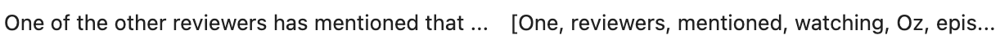
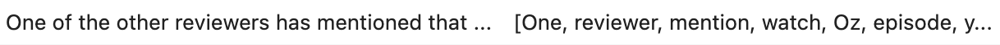

# NSDC_F23_movie_reviews_project

## Overview
In fall quarter of 2023, I completed a team project with National Student Data Corps (NSDC) at UCLA, in which we performed word sentiment analysis on 20,000 movie reviews to determine what words were most influential in determining whether a review was positive or negative. While our final presentation is no longer available, I was able to preserve the code that I wrote. Therefore, this repository only contains my contributions. 

## Data
The Kaggle dataset we used can be found [here](https://www.kaggle.com/datasets/lakshmi25npathi/imdb-dataset-of-50k-movie-reviews). The original dataset contains 50,000 total movie reviews: 25,000 for training and 25,000 for testing. Since our goal was to analyse fitted classifier coefficients rather than to create a strong predictor, we initially decided to fit our model on all 50,000 reviews directly. However, after facing computational limitations, we reduced our dataset to just the first 20,000 reviews.

## Preprocessing
1) Non-English characters and punctuation were removed from each review using regular expression patterns
2) Each review was tokenized into an array of individual words
   
3) Stop words were removed from each review. Stop words are high-frequency words that don't contribute significant sentiment (e.g., of, the, has). Notice the difference in the token array between the below image and the above image
   
4) Words in each review were lemmatized. Lemmatization is a generalization of words to their base form. For instance, we can generalize "goes" and "going" to "go". In the below image, notice that "mentioned" and "watching" have been changed to "mention" and "watch" respectively
   

## Modeling

## Creating Rating Bins
