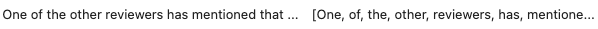

# NSDC_F23_movie_reviews_project

## Overview
In fall quarter of 2023, I completed a team project with National Student Data Corps (NSDC) at UCLA, in which we performed word sentiment analysis on 20,000 movie reviews to determine what words were most influential in determining whether a review was positive or negative. While our final presentation is no longer available, I was able to preserve the code that I wrote. Therefore, this repository only contains my contributions. 

My tasks included:
- preprocessing the data using tokenization, stopword removal, and lemmatization
- running logistic regression on the data to assign a weight (coefficient) to each unique word that appeared in the data
- calculating the sum of the word weights for each review
- grouping reviews into bins based on summed word weights
- testing the validity of our bins on sample online movie reviews

## Data
The Kaggle dataset we used can be found [here](https://www.kaggle.com/datasets/lakshmi25npathi/imdb-dataset-of-50k-movie-reviews). The original dataset contains 50,000 total movie reviews: 25,000 for training and 25,000 for testing. Since our goal was to analyse fitted classifier coefficients rather than to create a strong predictor, we initially decided to fit our model on all 50,000 reviews directly. However, after facing computational limitations, we reduced our dataset to just the first 20,000 reviews.

## Preprocessing
1) Non-English characters and punctuation were removed from each review using regular expression patterns
2) Each review was tokenized into an array of individual words
   
3) ...

## Modeling

## Creating Rating Bins
