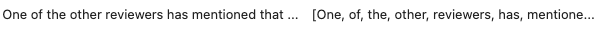
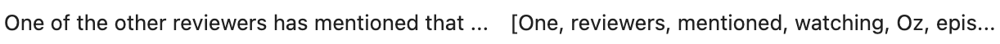
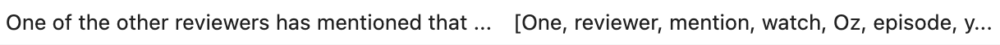

# NSDC_F23_movie_reviews_project

## Overview
In fall quarter of 2023, I completed a team project with National Student Data Corps (NSDC) at UCLA, in which we performed word sentiment analysis on 20,000 movie reviews to determine what words were most influential in determining whether a review was positive or negative. While our final presentation is no longer available, I was able to preserve the code that I wrote. Therefore, this repository only contains my contributions

Since 2023, I've learned a lot more about data science, so I've gradually refined the methodology of this project with new knowledge

## Data
The Kaggle dataset we used can be found [here](https://www.kaggle.com/datasets/lakshmi25npathi/imdb-dataset-of-50k-movie-reviews). The original dataset contains 50,000 total movie reviews, though we opted to only use 25,000 to save on compute

## Preprocessing
1) Non-English characters and punctuation are removed from each review using regular expression patterns
2) Each review is tokenized into an array of individual words
   
3) Stop words are removed from each review. Stop words are high-frequency words that don't contribute significant sentiment (e.g., of, the, has). Notice the difference in the token array between the below image and the above image
   
4) Words in each review are lemmatized. Lemmatization is a generalization of words to their base form. For instance, we can generalize "goes" and "going" to "go". In the below image, notice that "mentioned" and "watching" have been changed to "mention" and "watch" respectively
   
5) Lastly, we use `scikit-learn`'s `CountVectorizer` to identify the unique words in the dataset and how many times each of the words appears in each review. ***IMPORTANTLY***, instead of vectorizing all 25,000 reviews simultaneously, `CountVectorizer` is included as a preprocessing step in a `scikit-learn` `Pipeline` object during modeling to avoid data leakage from data splitting!

## Modeling

### Predictors used
Word counts returned by `CountVectorizer` are used as predictors

### Data splitting
80:20 train-test split, stratified by sentiment

### Evaluation
There isn't a class imbalance and the cost of misclassifying a positive review is the same as the cost of misclassifying a negative review, so accuracy serves as a sufficient evaluation metric

### Model Selection
The `C` regularization hyperparameter in `scikit-learn`'s `LogisticRegression` is tuned using 5-fold CV on the training set over the grid {0.0001, 0.001, 0.01, 0.1, 1, 10, 100, 1000, 10000}. `max_iter` is fixed at 1000

### Model Assessment
The logistic regression model is refit on the entire training set with the optimal value for `C`, then used to predict the sentiment of the reviews in the test set

## Creating rating bins
in progress...
